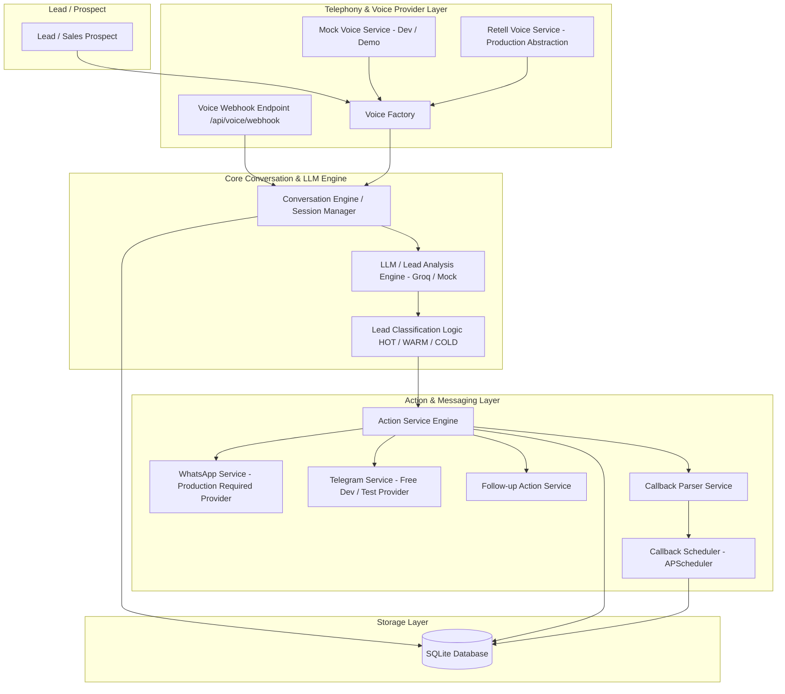

# LeadVoice AI

An intelligent, multilingual AI voice agent and lead-qualification engine designed to automate sales calls, analyze buying intent, schedule callbacks, and execute real-time actions.

---

## 1. Overview
LeadVoice AI automates inbound and outbound lead qualification calls. It engages prospects in natural sales conversations, extracts key buying signals (budget, timeline, product catalog size, decision makers, barriers), classifies leads into `HOT`, `WARM`, or `COLD` tiers, and triggers real-time messaging alerts and automated callback scheduling.

---

## 2. Problem Statement
Sales teams lose significant time and revenue on unqualified leads, manual data entry, delayed follow-ups, and language barriers. Traditional IVRs and static web forms fail to capture dynamic customer intent or handle natural multi-turn conversations. LeadVoice AI solves this by performing human-like, consultative voice discovery, instant classification, and real-time action dispatch.

---

## 3. Key Features
- **Outbound & Inbound Voice Automation**: Conversational AI agent for lead discovery and qualification.
- **Multilingual Support**: English, Hindi / Hinglish, Telugu / Teluglish, and mixed-language handling.
- **Progressive Intelligence Extraction**: Multi-turn accumulation of business type, budget, timeline, catalog size, decision maker, and barriers.
- **Real-Time Intent Classification**: Instant `HOT`, `WARM`, `COLD` evaluation with confidence scoring.
- **Automated Actions**: Immediate `HOT` lead alert dispatch, document attachment sending (resume, architecture diagram), and `WARM` callback scheduling.
- **Natural Callback Expressions**: Interprets phrases like "tomorrow morning" or "next Monday at 3 PM" into IST timestamps.
- **Provider Abstractions**: Modular abstractions for Voice (`MockVoiceService`, `RetellVoiceService`) and Messaging (`WhatsAppService`, `TelegramService`, `MockMessagingService`).
- **Zero-Cost Local Execution**: Operates 100% locally in `MOCK_MODE=true` without requiring paid third-party subscriptions.

---

## 4. Architecture



---

## 5. Technology Stack
- **Framework**: FastAPI (Python 3.10)
- **Database**: SQLite (SQLAlchemy ORM)
- **LLM Engine**: Groq API (`llama3-8b-8192`) with fallback deterministic mock analyzer
- **Task Scheduling**: APScheduler (in-process background scheduler)
- **Voice Providers**: `MockVoiceService` (development), `RetellVoiceService` (production abstraction)
- **Messaging Providers**: `WhatsAppService` (production requirement abstraction), `TelegramService` (free dev/test), `MockMessagingService`
- **Containerization**: Docker (`python:3.10-slim`)

---

## 6. Conversation Flow
1. **Call Initiation**: System initializes call context and sends welcoming agent greeting.
2. **Turn-by-Turn Spoken Interaction**: Customer speech turn is processed by the Conversation Engine.
3. **Progressive Fact Extraction**: Accumulates product catalog size, budget, timeline, decision-maker status, and barriers across turns.
4. **Classification & Action Check**: Evaluates lead tier after every turn and triggers immediate action if threshold is reached.
5. **Call Completion**: Summarizes transcripts, persists final lead state, and executes post-call follow-ups.

---

## 7. Lead Classification
- **HOT**: Explicit buying intent, high product count, clear budget, urgent timeline, and decision-maker involvement.
- **WARM**: Expresses clear interest but has a specific objection/barrier (e.g. partner review) or requests a callback.
- **COLD**: Low buying intent, casual exploration, no budget or timeline defined.

---

## 8. HOT / WARM / COLD Actions
- **HOT Action**: Triggers real-time `HOT_LEAD_ALERT` with executive summary and proposal links via WhatsApp / Telegram.
- **WARM Action**: Parses relative callback expression into an IST datetime and creates a scheduled callback job in APScheduler.
- **COLD Action**: Logs basic follow-up recommendation and avoids triggering high-priority alerts.

---

## 9. Callback Scheduling
Resolves expressions like "tomorrow morning", "this evening at 5 PM", or "next Monday" relative to reference time in `Asia/Kolkata` (IST) timezone and registers background execution jobs in database and scheduler.

---

## 10. Messaging
Provider abstraction layer supporting text messages, document attachments (resume), and image attachments (architecture diagram) across Telegram, WhatsApp, and Mock providers with built-in idempotency protection.

---

## 11. Voice Provider Abstraction
Decouples telephony integration from core conversation engine via `BaseVoiceService`. `MockVoiceService` allows zero-cost local testing, while `RetellVoiceService` and `/api/voice/webhook` enable seamless production telephony connection.

---

## 12. Setup

1. **Clone & Navigate**:
   ```bash
   git clone <repository_url>
   cd "LeadVoice AI"
   ```

2. **Create & Activate Virtual Environment**:
   ```bash
   python -m venv .venv
   .venv\Scripts\activate
   ```

3. **Install Dependencies**:
   ```bash
   pip install -r requirements.txt
   ```

---

## 13. Environment Variables

Copy `.env.example` to `.env`:
```bash
copy .env.example .env
```

Key configuration parameters:
```env
PORT=8000
HOST=127.0.0.1
MOCK_MODE=true
VOICE_PROVIDER=mock
MESSAGING_PROVIDER=telegram
DATABASE_URL=sqlite:///./leadvoice.db
GROQ_API_KEY=
RETELL_API_KEY=
TELEGRAM_BOT_TOKEN=
WHATSAPP_ACCESS_TOKEN=
```

---

## 14. Running Locally

Start the Uvicorn ASGI server:
```bash
.venv\Scripts\python -m uvicorn app.main:app --reload
```
Application will be available at `http://127.0.0.1:8000`.

---

## 15. Running Tests

Run the complete automated test suite:
```bash
.venv\Scripts\python -m pytest tests/
```

Execute deterministic demo scripts:
```bash
.venv\Scripts\python scratch/demo_hot.py
.venv\Scripts\python scratch/demo_warm.py
.venv\Scripts\python scratch/demo_cold.py
.venv\Scripts\python scratch/demo_multilingual.py
```

---

## 16. Docker

Build and run using Docker:
```bash
docker build -t leadvoice-ai .
docker run -p 8000:8000 --env MOCK_MODE=true leadvoice-ai
```
*(Note: Docker configuration reviewed; local image execution could not be performed because Docker Engine is unavailable on host environment).*

---

## 17. Deployment

- **Deployment URL**: `TBD` (Prepared for container platform deployment; see [`docs/deployment.md`](file:///e:/PROJECTS/LeadVoice%20AI/docs/deployment.md))
- **Deployment Mode**: `MOCK_MODE=true` for zero-cost, dependency-free cloud startup.
- **Container Environment Variables**:
  - `PORT=8000` (respects platform `$PORT` injection)
  - `HOST=0.0.0.0`
  - `MOCK_MODE=true`
  - `VOICE_PROVIDER=mock`
  - `MESSAGING_PROVIDER=telegram`
- **Health Verification**:
  - Health check: `GET /health` -> `{"status": "healthy"}`
  - Readiness check: `GET /health/ready` -> `{"status": "ready", "database": "connected"}`
- **Live Provider Activation (Optional)**: Provide `GROQ_API_KEY`, `RETELL_API_KEY`, and `WHATSAPP_ACCESS_TOKEN` when connecting live production accounts.

---

## 18. Demo Walkthrough

Concise API walkthrough examples:

### 1. Start a Mock Call
`POST /api/voice/mock/start`
```json
{
  "phone_number": "9353352276",
  "customer_name": "Surya",
  "language": "English"
}
```

### 2. Send a Transcript Turn
`POST /api/voice/mock/message`
```json
{
  "call_id": "call_123456789abc",
  "message": "I need an e-commerce website for 500 products. My budget is 1 lakh."
}
```

### 3. End the Call
`POST /api/voice/mock/end`
```json
{
  "call_id": "call_123456789abc"
}
```

### 4. Retrieve Call Information
`GET /api/voice/calls/call_123456789abc`

### 5. HOT Lead Action
`POST /api/actions/process-lead`
```json
{
  "lead_id": 1,
  "provider": "telegram"
}
```

### 6. WARM Callback
`POST /api/callbacks/schedule`
```json
{
  "lead_id": 1,
  "callback_expression": "tomorrow morning"
}
```

### 7. COLD Follow-Up
`POST /api/whatsapp/followup`
```json
{
  "lead_id": 1,
  "provider": "telegram"
}
```

### 8. Health Check
`GET /health`

### 9. Readiness Check
`GET /health/ready`

---

## 19. API Reference
For complete REST endpoint contracts, HTTP methods, schemas, and example payloads, see [`docs/api_reference.md`](file:///e:/PROJECTS/LeadVoice%20AI/docs/api_reference.md).

---

## 20. Assignment Feature Matrix

| Requirement | Implementation | Status |
| :--- | :--- | :--- |
| **Outbound voice agent** | `MockVoiceService` & `RetellVoiceService` | IMPLEMENTED / MOCK/DEMO |
| **Natural conversation** | `ConversationEngine` stateful multi-turn prompts | IMPLEMENTED |
| **English** | Multilingual prompt & LLM analyzer | IMPLEMENTED |
| **Hindi** | Hinglish / Hindi spoken prompt & extraction | IMPLEMENTED |
| **Telugu** | Teluglish / Telugu spoken prompt & extraction | IMPLEMENTED |
| **Mixed-language conversation** | Automatic turn language detection & response | IMPLEMENTED |
| **Business/product discovery** | `LeadAnalysis` catalog size & business extraction | IMPLEMENTED |
| **Budget discovery** | Currency parsing (INR / USD) & threshold matching | IMPLEMENTED |
| **Timeline discovery** | Natural timeline parser (weeks/months) | IMPLEMENTED |
| **Required features** | Array list extraction & persistence | IMPLEMENTED |
| **Decision-maker information** | Role detection (founder, partner, manager) | IMPLEMENTED |
| **Objection handling** | Barrier extraction & storage under `objections_or_barriers` | IMPLEMENTED |
| **HOT/WARM/COLD classification** | Dynamic intent classification engine | IMPLEMENTED |
| **HOT messaging action** | Real-time `HOT_LEAD_ALERT` with idempotency | IMPLEMENTED / MOCK/DEMO |
| **WARM callback scheduling** | `APScheduler` job creation & DB persistence | IMPLEMENTED |
| **COLD follow-up** | Basic follow-up recommendation & safe logging | IMPLEMENTED |
| **Natural callback expressions** | `CallbackParserService` relative date parser | IMPLEMENTED |
| **Conversation-based personalization** | Dynamic message builder using extracted facts | IMPLEMENTED |
| **Database persistence** | SQLite ORM (`Lead`, `Call`, `TranscriptLine`, `ScheduledCallback`, `WhatsAppEvent`) | IMPLEMENTED |
| **Voice provider abstraction** | `BaseVoiceService` factory (`mock` / `retell`) | INTEGRATION-READY |
| **WhatsApp integration abstraction** | `WhatsAppService` Cloud API implementation | INTEGRATION-READY / NOT LIVE-VALIDATED |
| **Mock/demo mode** | Zero-cost `MOCK_MODE=true` local execution | IMPLEMENTED |

---

## 21. Limitations
- **Local In-Process Scheduler**: APScheduler runs inside the main FastAPI process with SQLite. Horizontal clustering across multi-region deployments would require Redis / Celery.
- **Live Third-Party API Validation**: Retell AI voice streaming and Meta WhatsApp Cloud API abstractions are implemented and integration-ready, but have not been live-validated with paid production accounts.

---

## 22. Future Improvements
- **Production Telephony**: Attach live Retell WebRTC / SIP trunks for real-time audio STT/TTS streams.
- **Distributed Event Queue**: Integrate Redis & Celery for asynchronous distributed background job execution.
- **CRM Integrations**: Webhook streaming into HubSpot and Salesforce CRMs.

