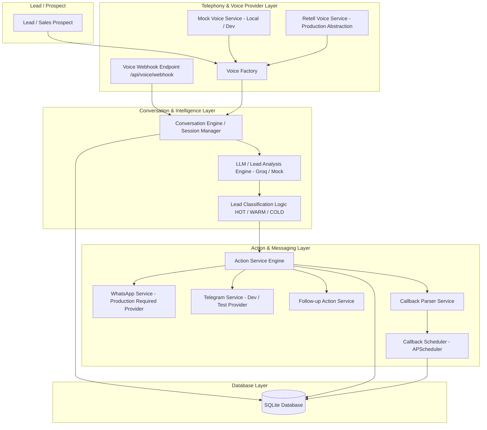
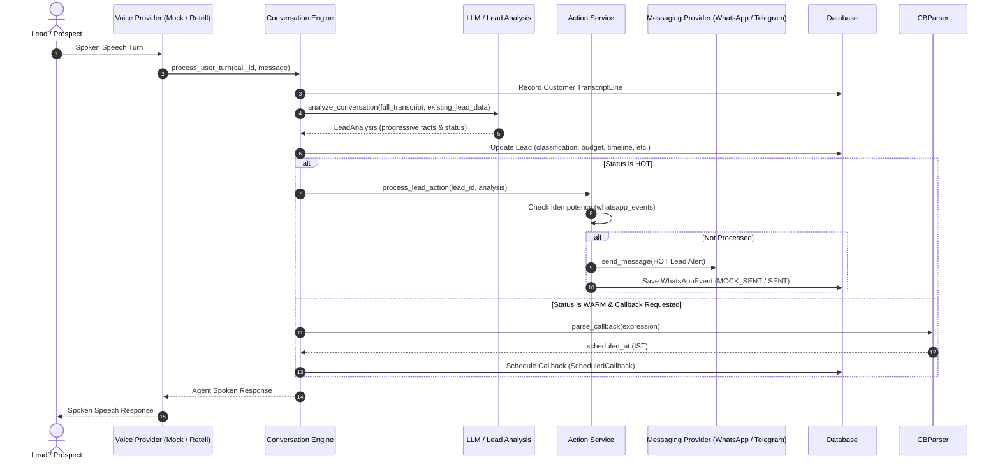
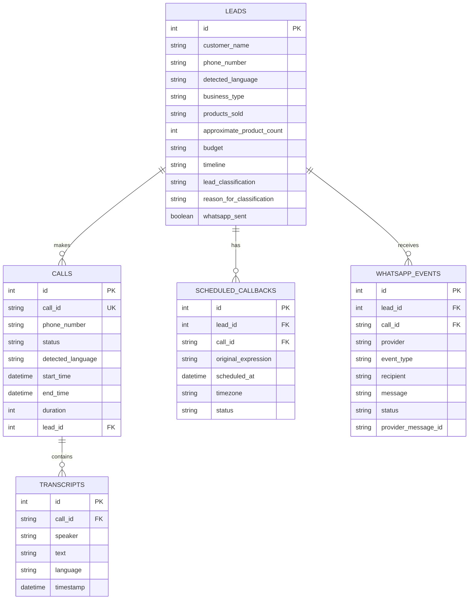

# LeadVoice AI — System Architecture Document

## 1. System Overview
LeadVoice AI is an intelligent multilingual voice agent designed to qualify inbound and outbound sales leads, extract business requirements during natural spoken conversations, perform real-time intent classification (`HOT`, `WARM`, `COLD`), trigger mid-call alert actions, schedule callbacks, and execute personalized follow-up messaging.

---

## 2. Component Architecture

---

## 3. Provider Abstraction Scoping
- **Voice Providers**:
  - `MockVoiceService`: Local zero-cost testing without external dependencies.
  - `RetellVoiceService`: Telephony integration provider abstraction for production voice streaming.
- **Messaging Providers**:
  - `WhatsAppService`: Production-required messaging provider (Meta WhatsApp Cloud API abstraction).
  - `TelegramService`: Free development and testing messaging provider.

---

## 4. Conversation & Intelligence Flow

---

## 5. Lead Classification Rules
- **HOT**: Customer demonstrates high buying intent, explicit budget, defined launch timeline, and product specifications (`recommended_action`: `SEND_WHATSAPP_NOW`).
- **WARM**: Prospect expresses interest but presents an objection/barrier (e.g. partner discussion, budget review) or requests a callback (`recommended_action`: `SCHEDULE_CALLBACK`).
- **COLD**: Casual inquiry, general exploration, or lack of immediate timeline/budget (`recommended_action`: `SEND_FOLLOWUP`).

---

## 6. Database Entity Relationship Model

---

## 7. Deployment Architecture
- **Containerization**: Docker lightweight Linux container based on `python:3.10-slim`.
- **Process Manager**: Uvicorn ASGI server running FastAPI application on port 8000.
- **Database**: Embedded SQLite file-backed database with `init_db()` dynamic schema reflection.
- **Background Engine**: APScheduler in-process background scheduler.
